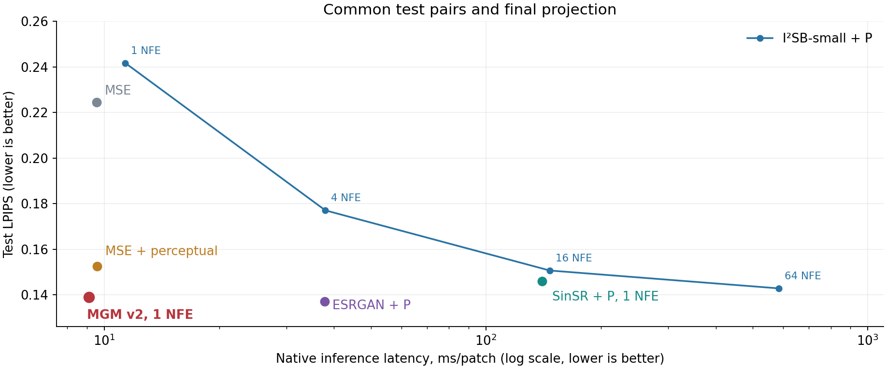
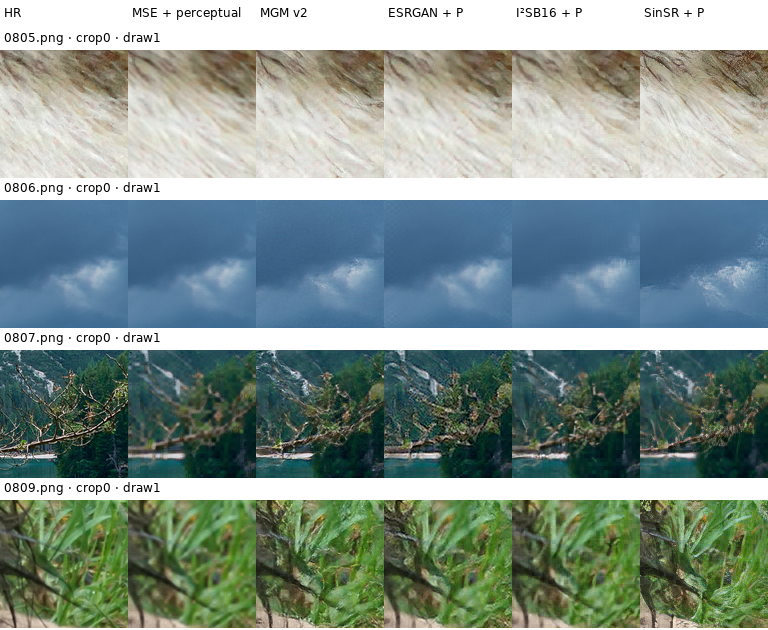

# Conditional MGM for Image Super-Resolution

A PyTorch research project adapting **Midpoint Generative Models (MGM)** to paired image-to-image translation. The experiment studies **one-pass ×4 super-resolution** under a known average-pooling degradation: **LR32 → HR128**.

**Selected model:** 16.02M inference parameters · 9.13 ms/patch on V100 · test LPIPS 0.13908. Against our compact I²SB at 16 NFE with the same final projection, it achieves **7.7% lower mean LPIPS at ≈16× lower native inference latency**, with lower PSNR/SSIM.

[Presentation](docs/presentation.pdf) · [Method](docs/METHOD.md) · [Reproduce](docs/REPRODUCING.md) · [Full results](docs/results/test_metrics.csv)

## What I implemented

- **Conditional MGM:** compare generated and real HR endpoints sharing the same LR condition, using a conditional displacement field.
- **Two residual U-Nets:** widths 120/240/480, with a bounded residual in v1 and an unrestricted residual plus sinusoidal field time embeddings in v2.
- **Data consistency:** an established null-space projection enforces the known LR observation before clipping.
- **Training and evaluation:** warm-started field, 50/50/80-epoch schedule, five noise regimes per architecture, three seeds, Slurm job arrays, fixed test pairs and paired photo-bootstrap analysis.

For $C=DY$, where $D$ is average pooling ×4:

$$
X_0=G_\theta(C,Z),\quad X_1=Y,\qquad
f_\psi(C,t,\widetilde X_t)\approx\mathbb E[Y-X_0\mid C,t,\widetilde X_t].
$$

$$
G_{v1/v2}(c,z)=\Pi_c\!\left(U(c)+h_{v1/v2}(F_\theta([U(c),z]))\right),\quad
h_{v1}=\tanh,\quad h_{v2}=\mathrm{id},
$$

$$
\Pi_c(v)=v+R(c-Dv),\qquad DR=I,\qquad D\Pi_c(v)=c.
$$

$U$ is bicubic upsampling; $R$ repeats each LR pixel over its 4×4 HR block. Projection follows [GAN Prior Based Null-Space Learning for Consistent Super-Resolution](https://ojs.aaai.org/index.php/AAAI/article/view/25372), rather than being a new MGM contribution.

## Test results

DIV2K: **800 train / 50 validation / 50 test photographs**. Training uses four fresh crop128 patches per photo per epoch; evaluation uses five fixed crops per photo. Local results average three training seeds. The primary v2/no-interpolant-noise recipe was selected on validation; its latent input remains random.

| Model | PSNR ↑ | LPIPS ↓ | Native latency, ms ↓ |
|---|---:|---:|---:|
| MSE U-Net | **31.476** | 0.22444 | 9.56 |
| MSE + VGG perceptual | 30.993 | 0.15251 | 9.58 |
| ESRGAN + P | 28.943 | **0.13716** | 37.77* |
| I²SB-small, 16 NFE + P | 29.455 | 0.15068 | 146.95* |
| I²SB-small, 64 NFE + P | 28.904 | 0.14284 | 585.05* |
| MGM v1, no interpolant noise | <ins>28.167</ins> | <ins>0.13872</ins> | <ins>**9.08**</ins> |
| MGM v2, no interpolant noise | <ins>27.948</ins> | <ins>0.13908</ins> | <ins>9.13</ins> |
| SinSR, author checkpoint + P | 28.340 | 0.14600 | 140.21* |

Underlined: MGM. Bold: best displayed mean. **+P** applies the same final consistency projection; it is already built into MSE/perceptual/MGM. FP32, batch1, Tesla V100-SXM2-32GB. *Added projection time is excluded. [All 18 configurations, native/projected outputs, SSIM and uncertainty](docs/RESULTS.md).



MGM provides a useful speed–quality trade-off against our compact bridge. **A general quality advantage over ESRGAN or SinSR is not established.** ESRGAN uses standard RRDBNet geometry with our training recipe; I²SB-small is our compact adaptation, not the authors' ADM model. SinSR is externally pretrained and uses padding/VQ processing, so its timing and quality measure transfer to this benchmark.

## Visual comparison



First four test photographs, crop0, local seed0/draw1; original exported pixels. MGM is the validation-selected v2/no-interpolant-noise model. Smooth regions expose grain; sharp generated textures can differ from HR.

## Run

```bash
python -m venv .venv
source .venv/bin/activate
python -m pip install -r requirements.txt
python -m pytest -q tests
python scripts/train.py --config configs/toy_mgm.json
```

The toy example runs independently of DIV2K. For the reported CUDA/Slurm experiment, see [reproduction instructions](docs/REPRODUCING.md). Datasets and model checkpoints are not bundled. [`src/mgm_i2i/cluster`](src/mgm_i2i/cluster) contains the SR implementation; [`scripts`](scripts) and [`slurm`](slurm) contain planning, training and evaluation entry points.

Based on [Midpoint Generative Models](https://arxiv.org/abs/2605.29920). Compute: HSE University supercomputer. AI assistance: Codex Astra/Sol for analysis, implementation and editing. Earlier development notes are preserved in [the Russian README archive](README.ru.md).
