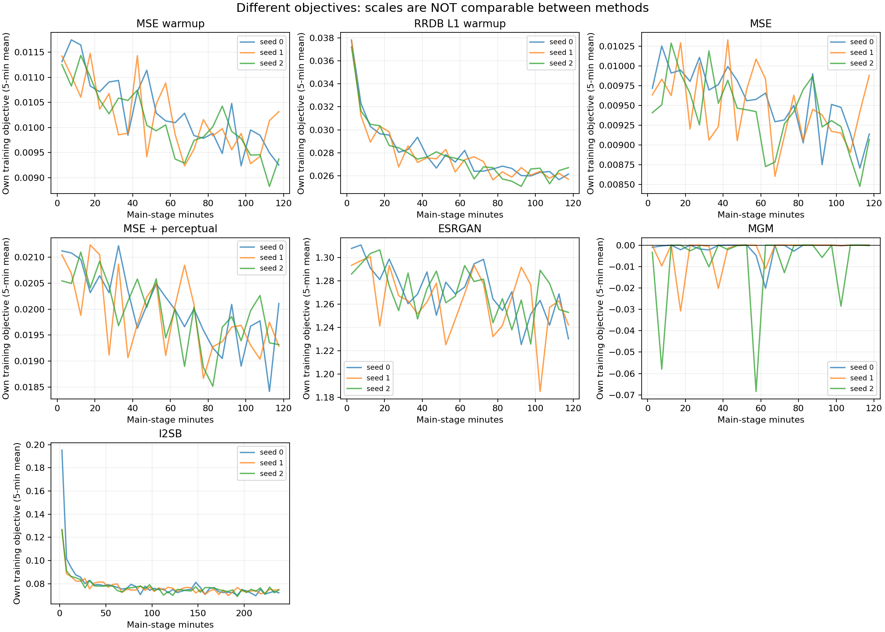
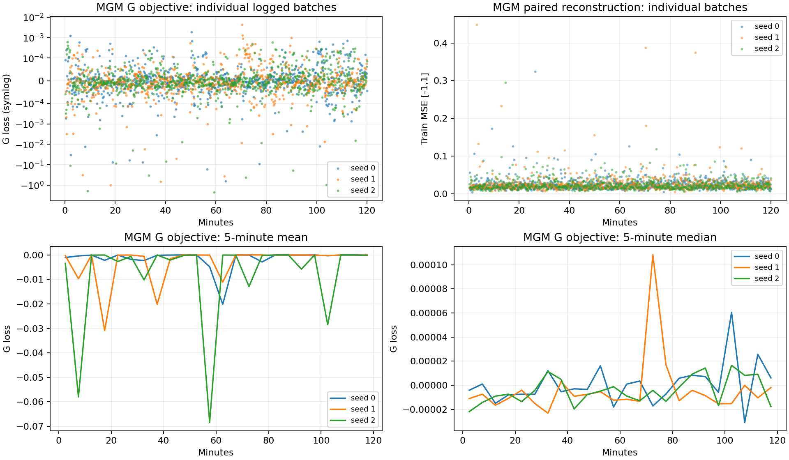
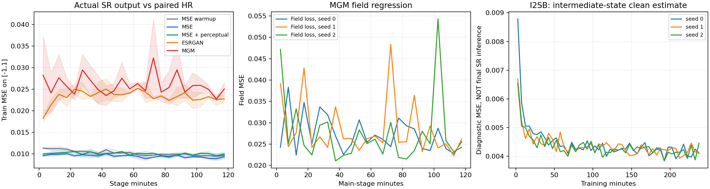
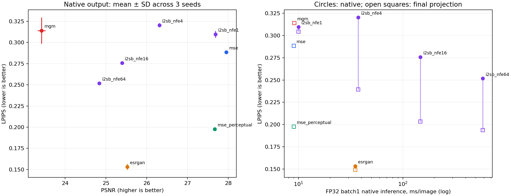
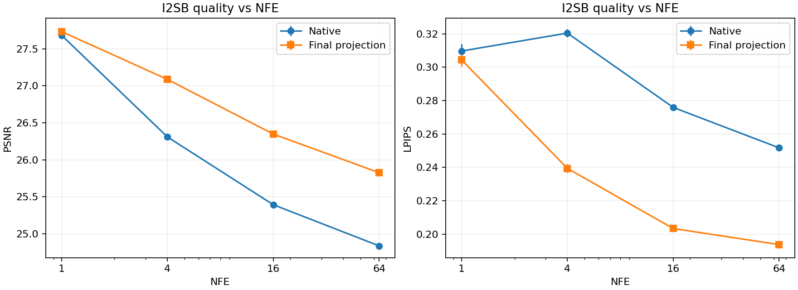
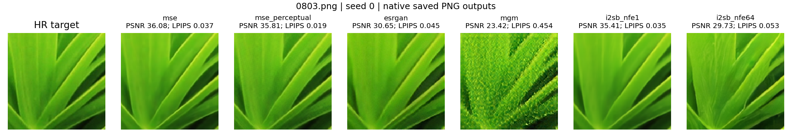
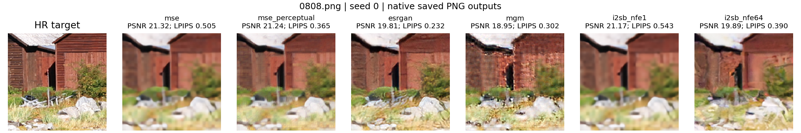
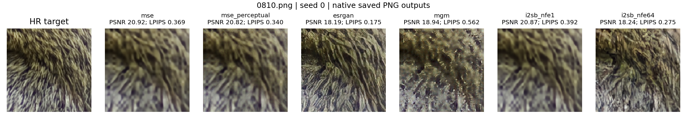
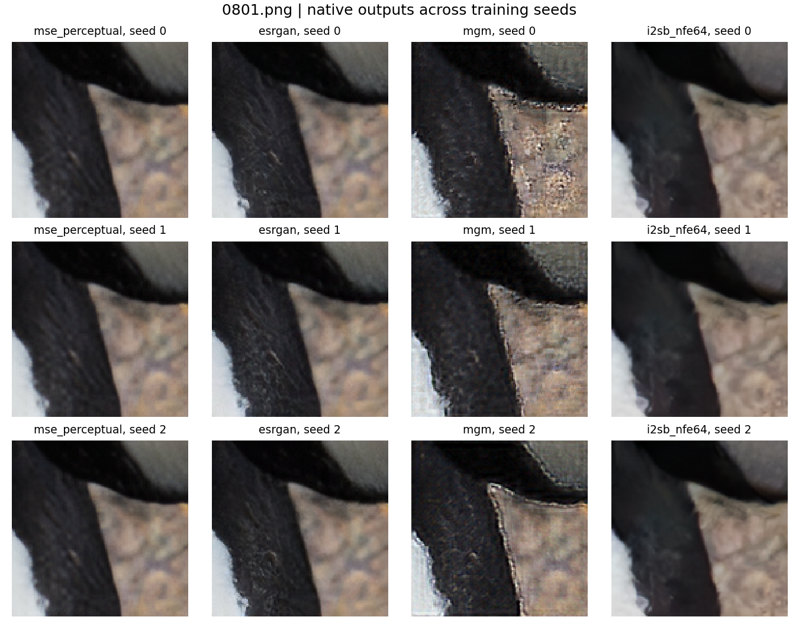

# Анализ серии sr_4c20214

Дата анализа: 18 октября 2026. Источник: `/Users/kirill/Downloads/sr_4c20214_results.tar.gz` (24 469 046 байт). SHA256 архива: `90c6465cefe71365f0c6385ab44293a3c62318ef12cbc58d7527184c93287fbb`.

Выполнен только анализ сохранённых JSON, логов, accounting и PNG. Обучение, инференс, загрузка checkpoints и GPU-тесты не запускались. Таблицы и фигуры воспроизводятся `analyze_results.py`; исходный архив распакован в `tmp/research/sr_4c20214_results`.

## Основной результат

В этой реализации, при этих настройках и бюджете преимущество MGM по качеству не показано. MSE+perceptual имеет ту же архитектуру и почти такую же задержку, но заметно лучшие PSNR/SSIM/LPIPS. ESRGAN даёт лучший средний LPIPS, хотя уступает MSE в попиксельной точности и работает медленнее. I²SB показывает понятную зависимость результата от NFE и сильный эффект финальной pooling projection. Эти наблюдения относятся к нашей адаптации, не к опубликованным системам авторов.

## 1. Обучение

### Полнота и ресурсы

- Присутствуют все 6 warmup и 15 основных training runs, 24/24 validation evaluations.
- Slurm: все 46 parent jobs (21 training, 24 eval, 1 collect) — COMPLETED, ExitCode=0:0. Подзадачи .batch/.extern/.0 не суммировались повторно; посторонние jobs из общей выгрузки исключены по job IDs из submission.json.
- Все 21 status: complete=true, received_signals=[]; одна сохранённая session. Логи конечны, шаги последовательны, счётчики updates/consumed согласованы. Проверены конфигурации против подписанного плана и hash manifest. Автоматических несоответствий не найдено.
- Все recorded GPU — Tesla V100-SXM2-32GB, torch 2.6.0+cu118/CUDA11.8. Увеличенные сети действительно помещаются на одной такой GPU: максимальный recorded PyTorch peak allocated у MGM 9.445 GiB. Это не полный расход VRAM и не peak reserved.
- Train/val/test исходные фотографии не пересекаются: 800/50/50. На validation по одному center128; training — online random128, pooling ×4, без resize/flip/rotation согласно config и версии реализации.
- MSE/MSE+perceptual/MGM имеют одинаковый init_hash внутри каждого seed. ESRGAN имеет свой RRDB warmup; I²SB — init_hash=null. Без checkpoints повторно проверить байты warmup нельзя.

Фактический training timer: **48.0006 GPU-часа**. Slurm training allocations: **48.4389 GPU-часа**, eval allocations: **0.2047 GPU-часа**; сумма GPU allocations **48.6436 ч**. Разница включает startup, checkpoint I/O и завершение. Полного календарного времени/ожидания очереди из этой выгрузки не восстановить: отсутствуют Start/End/Submit.

MSE warmup и RRDB warmup — по 2 часа на seed. Основной MSE/MSE+perceptual/ESRGAN/MGM — ещё 2 часа. I²SB — 4 часа с нуля. Таким образом, каждому методу условно приписываются 4 часа/seed; физическая сумма меньше суммы пяти независимых pretraining из-за общего MSE warmup. Равные часы не означают равные updates: у MGM в main около 15.8 тыс. G updates, у MSE 49.3 тыс., у I²SB за четыре часа 96.7 тыс.

### Насколько снизился loss

Ниже: сначала среднее записанных каждые 20 steps batch losses внутри окна, затем среднее трёх seed. Это не loss первого и последнего батча. Первые 10 минут считаются от training timer; первый записанный warmup seed0 появился только на 133-й секунде, поэтому самый ранний startup-интервал не покрыт логом. Loss на момент нулевого шага неизвестен.

| Этап | Средние шаги | Loss первых 10 мин | Loss последних 10 мин | Изменение |
|---|---:|---:|---:|---:|
| MSE warmup | 48,615 | 0.0112874 | 0.00956937 | -15.2% |
| RRDB L1 warmup | 38,489 | 0.0346157 | 0.0261541 | -24.4% |
| MSE | 49,275 | 0.00972951 | 0.00911537 | -6.3% |
| MSE + perceptual | 41,393 | 0.0208264 | 0.01937 | -7.0% |
| ESRGAN | 33,721 | 1.29847 | 1.25223 | -3.6% |
| MGM | 15,786 | -0.0122993 | -3.18001e-05 | процент не интерпретируем |
| I²SB | 96,719 | 0.113959 | 0.0735695 | -35.4% |

Числа разных строк не являются общей шкалой качества: MSE, MSE+VGG, L1, GAN composite, MGM variational objective и I²SB normalized target MSE имеют разные определения. I²SB diagnostic `mse` измеряет clean estimate из случайного training bridge state; это не MSE результата reverse sampler при inference.

- MSE warmup снизил train MSE на 15.2%, последующее MSE — ещё на 6.3% между началами/концами своего main stage.
- MSE+perceptual composite снизился на 7.0%; его train pixel MSE — на 3.0%.
- RRDB L1 warmup снизился на 24.4%; diagnostic MSE — на 28.8%.
- ESRGAN composite снизился на 3.6%, но diagnostic paired MSE вырос на 14.4%. Это согласуется с уходом от точной реконструкции к feature/adversarial цели; само по себе не означает численную нестабильность. Раздельные pixel/VGG/GAN terms не логировались, их вклад по архиву не восстановить.
- I²SB objective снизился на 35.4%. Между предпоследним и последним 10-минутным окном средний objective не улучшился (0.07301 → 0.07357); основное снижение произошло раньше. Это не доказывает оптимальности модели.

### Стабильность MGM

Численного NaN/Inf-взрыва и пропусков G у MGM нет. Однако оптимизация заметно менее ровная:

- В 2367 записанных MGM-батчах есть **13** значений G loss ниже −0.1; минимум по seed: -0.6442674398422241, -1.0168215036392212, -2.257316827774048.
- В **20** записанных батчах MSE >0.1; максимумы по seed: 0.325, 0.448, 0.295. Это единичные записанные батчи, а не доля всех updates: логирование раз в20 шагов.
- Пятиминутные средние G objective чувствительны к редким отрицательным выбросам, медиана в основном близка к нулю. Процентное «снижение MGM loss» здесь вводит в заблуждение.
- Истинный midpoint divergence неотрицателен, но обучаемый variational estimate при неидеальном поле и конечном batch может быть отрицательным. Ни отрицательное значение, ни близость к нулю не доказывают совпадения распределений.
- MGM train reconstruction MSE остаётся около 0.024 к концу, против 0.0091 у MSE. Поэтому небольшой G objective нельзя трактовать как качественное SR.
- Field loss в среднем 0.03297 → 0.02416, но тоже имеет всплески. Положительный regression loss может содержать несводимую условную дисперсию; само его значение не доказывает, что поле «не обучается».

Пропуски AMP редки: в main MSE суммарно38 G skips, MSE+perceptual33, ESRGAN7, MGM0, I²SB97. Доля G skips в каждом отдельном run <0.036%. Максимальная доля auxiliary skips <0.10%. Это не объясняет систематическое падение качества MGM. Gradient norms, частота clipping и AMP scale не записаны; исключить влияние clipping или локальных gradient spikes невозможно.

Плато последних окон говорит только о замедлении этой training objective при текущей настройке. Промежуточных validation-кривых нет, поэтому ни полную сходимость, ни переобучение по train loss не устанавливаем.

## 2. Метрики и как они получены

Оценивались EMA последнего completed checkpoint, без выбора best checkpoint по validation. Для I²SB NFE1/4/16/64 внутри seed совпадает checkpoint SHA. Все результаты — validation, held-out test в архиве отсутствует.

- Общие 50 HR/LR-пар, HR128/LR32, одно фото — один crop. Manifest SHA: `35733de105a964d20cb2082174c6af1a439dd940d2daeff60611a580bb21c387`.
- PSNR: выход clip в [-1,1], перевод вместе с HR в [0,1], MSE по RGB-компонентам, затем −10 log10(MSE). Среднее PSNR по 50 изображениям, а не PSNR от общего MSE.
- SSIM: RGB, окно11×11 Gaussian sigma1.5, valid convolution, data_range=1; без отдельного border shave.
- LPIPS: AlexNet v0.1, clipped [-1,1], исходный размер128; не VGG19, который используется в training loss.
- Один заранее заданный draw0 даёт основные quality metrics. Второй draw используется для diversity; best-of-N не выбирался. У deterministic методов и I²SB NFE1 diversity=0, как ожидается.
- Для native outputs и отдельно final pooling projection метрики считаются одинаково. Проекция применяется перед clipping, не внутри reverse chain.
- Внутри каждого seed значения усреднены по фото; таблица — среднее±sample SD трёх trained seeds. SD между seed не является доверительным интервалом по новым фотографиям.
- Latency: FP32, batch1, одинаковая модель GPU; CUDA synchronize, первый batch исключён. Полный reverse sampler с noise/NFE входит в timing; transfer, LPIPS/SSIM, сохранение и финальная projection — нет. Это среднее49 timings; сами timings/quantiles в архиве не сохранены. Число не включает все расходы end-to-end приложения.

Из per-image JSON повторно вычислены все aggregate metrics: совпадают с результатами. Фиксированные bicubic baselines совпадают на всех50 фото во всех24 eval. Первые четыре колонки сохранённых PNG (LR/bicubic/projected bicubic/HR) побитово совпадают во всех grids. Но полного пересчёта float metrics без model checkpoints и HR banks не выполняли.

| Метод | PSNR ↑ | SSIM ↑ | LPIPS ↓ | PSNR с проекцией ↑ | LPIPS с проекцией ↓ | мс/изображение ↓ |
|---|---:|---:|---:|---:|---:|---:|
| MSE | 27.952 ± 0.013 | 0.7574 ± 0.0001 | 0.2885 ± 0.0009 | 27.952 ± 0.013 | 0.2885 ± 0.0009 | 9.00 ± 0.03 |
| MSE + perceptual | 27.670 ± 0.021 | 0.7452 ± 0.0005 | 0.1976 ± 0.0004 | 27.670 ± 0.021 | 0.1976 ± 0.0004 | 9.03 ± 0.14 |
| ESRGAN | 25.524 ± 0.023 | 0.6685 ± 0.0035 | 0.1532 ± 0.0034 | 26.035 ± 0.025 | 0.1491 ± 0.0022 | 34.99 ± 0.79 |
| MGM | 23.419 ± 0.094 | 0.5413 ± 0.0098 | 0.3141 ± 0.0155 | 23.419 ± 0.094 | 0.3141 ± 0.0155 | 9.12 ± 0.03 |
| I²SB NFE1 | 27.683 ± 0.036 | 0.7476 ± 0.0013 | 0.3097 ± 0.0042 | 27.733 ± 0.035 | 0.3044 ± 0.0039 | 9.99 ± 0.13 |
| I²SB NFE4 | 26.309 ± 0.019 | 0.6937 ± 0.0009 | 0.3204 ± 0.0024 | 27.087 ± 0.020 | 0.2394 ± 0.0025 | 37.46 ± 0.13 |
| I²SB NFE16 | 25.393 ± 0.013 | 0.6559 ± 0.0009 | 0.2759 ± 0.0017 | 26.348 ± 0.014 | 0.2034 ± 0.0018 | 147.67 ± 0.44 |
| I²SB NFE64 | 24.837 ± 0.014 | 0.6274 ± 0.0015 | 0.2517 ± 0.0015 | 25.826 ± 0.014 | 0.1938 ± 0.0014 | 585.09 ± 1.41 |

### Интерпретация

1. **MSE** имеет лучшие средние PSNR/SSIM, но сглаживает неоднозначные детали.
2. **MSE+perceptual** снижает средний LPIPS на31.5% относительно MSE, теряя0.282 dB PSNR. LPIPS лучше на50/50 фото после усреднения по seed. При том же G и примерно9ms это сильный быстрый baseline.
3. **ESRGAN** имеет лучший средний LPIPS:0.1532 native и0.1492 projected, но native PSNR25.52 dB и около35ms. Он медленнее U-Net примерно в3.8 раза, несмотря на близкие параметры. GAN в этой серии не является худшим по perceptual metric.
4. **MGM**:23.42 dB и0.3141 LPIPS против27.67/0.1976 у MSE+perceptual при почти той же latency. У MP PSNR выше на50/50 фото; LPIPS лучше на42/50. По среднему LPIPS MGM хуже MSE на8.9%, но неоднородность по фотографиям велика: MGM выигрывает у MSE на24/50. Среднее отставание от MP —58.9%, от ESRGAN ещё больше. Нельзя утверждать, что каждый MGM sample хуже каждого baseline.
5. **I²SB**: рост NFE снижает PSNR и в режиме4→16→64 улучшает LPIPS native; LPIPS1→4 не монотонен. При final projection LPIPS улучшается монотонно от0.3044 до0.1938. Последний уже близок к MP0.1976, но PSNR ниже на1.84dB и latency примерно в65 раз больше. Малое среднее LPIPS-преимущество projected I²SB64 над MP неоднородно и неубедительно на50 фотографиях.

### Проекция и статистическая неоднородность

Projection особенно важна I²SB: NFE64 native0.2517 LPIPS → projected0.1938; PSNR24.84 →25.83. Поэтому сравнение только native I²SB с уже projected MGM смешивает метод и data consistency. Для ESRGAN эффект меньше:0.1532 →0.1492 LPIPS.

Raw LR MSE MGM/MSE порядка2e−15 заложен hard projection, а не доказательство превосходства objective. После clipping условие нарушается: MGM LR MSE≈5.38e−6 против≈1.29e−8 у MSE; у MGM вне диапазона примерно0.65% RGB-компонент. Это не массовое насыщение всего изображения, но часть различий полезно учитывать.

Дополнительно выполнен paired bootstrap по50 исходным фотографиям, предварительно усреднив каждое фото по3 seeds, 20000 resamples. Интервалы условны на этих трёх обученных моделях, не учитывают полную неопределённость новых обучений и являются exploratory, без поправки на множественные сравнения.

| Разность LPIPS (метод − reference) | Среднее | 95% bootstrap interval | Фото с улучшением |
|---|---:|---|---:|
| MGM − MSE | +0.0256 | [-0.0200, +0.0722] | 24/50 |
| MGM − MSE + perceptual | +0.1165 | [+0.0818, +0.1523] | 8/50 |
| MGM − ESRGAN | +0.1608 | [+0.1312, +0.1921] | 2/50 |
| MSE + perceptual − MSE | -0.0908 | [-0.1082, -0.0747] | 50/50 |
| ESRGAN − MSE + perceptual | -0.0444 | [-0.0582, -0.0314] | 42/50 |
| I²SB NFE64 − MSE + perceptual + projection | -0.0038 | [-0.0190, +0.0128] | 25/50 |
| MGM − I²SB NFE1 | +0.0044 | [-0.0420, +0.0517] | 27/50 |
| MGM − I²SB NFE64 | +0.0624 | [+0.0199, +0.1037] | 17/50 |
| MGM − I²SB NFE64 + projection | +0.1203 | [+0.0853, +0.1553] | 8/50 |
| MGM − ESRGAN + projection | +0.1649 | [+0.1353, +0.1962] | 0/50 |

Отрицательная разность LPIPS означает улучшение. Для MGM−MSE интервал пересекает0, поэтому сильный вывод по этой метрике на новой популяции фото не установлен. Для MGM−MP и MGM−ESRGAN отставание заметнее и устойчивее по фото. Проекцию не включали в latency; сравнение projected pipelines требует учитывать её дополнительную небольшую стоимость, которая здесь отдельно не замерена.

## 3. Визуальные примеры

В архиве сохранены только первые8 фиксированных validation изображений (0801,0802,0803,0804,0808,0810,0811,0812), а не любые из50. Все8 просмотрены. Сравнительные фигуры составлены из существующих PNG без нового inference, синтеза или enhancement. Они показывают **native outputs**, поскольку final-projected outputs отдельно не сохранялись. Цифры рядом взяты из float evaluation JSON; PNG quantization не использовалась для повторного расчёта метрик.

- **0801, чёрная шерсть и размытый фон:** MP и ESRGAN сохраняют гладкость фона; MGM добавляет заметную грубую зернистость. Эффект присутствует во всех3 seeds, поэтому это не один неудачный seed.
- **0802, цитрусы:** MSE сглаживает поверхность, MP/ESRGAN дают более похожую мелкую фактуру; MGM добавляет чрезмерную зернистость и меняет границы/светотень.
- **0803, гладкие зелёные листья:** сильный провал MGM: вместо чистой структуры появляется шумоподобная текстура. Seed0 LPIPS0.454 против0.019 MP; PSNR23.42 против35.81. I²SB1 похож на сглаженную реконструкцию; 64 шага не улучшают этот простой пример.
- **0804, одежда и джинсы:** ESRGAN восстанавливает более выраженную тканевую фактуру; у MGM грубые пятна и ложные детали, границы менее чистые.
- **0808, деревянные постройки и растительность:** это важный контрпример к «MGM всегда хуже»: seed0 MGM LPIPS0.302 лучше MSE0.505 и MP0.365, но хуже ESRGAN0.232. Добавленная текстура иногда помогает perceptual similarity, хотя пространственная точность остаётся ниже.
- **0810, мех:** ESRGAN и I²SB64 дают более правдоподобную выраженную фактуру, MSE/MP сглаживают, MGM формирует крупные пятна/артефакты. Детали GAN не следует автоматически считать точным восстановлением каждой волосинки.
- **0811, тёмная вода/камни:** MGM выглядит приемлемее, LPIPS0.174 лучше MSE0.224; MP0.133 и ESRGAN0.106 лучше. Это ещё один пример неоднородного эффекта.
- **0812, тёмная шерсть:** MGM не столь катастрофичен, как на листьях, но уступает MP/ESRGAN по чистоте и LPIPS.

Все8 сравнений доступны в `gallery.html`; остальные `sample_XXXX.png` лежат рядом. Таблица `per_image_mean.csv` содержит все50 фото. Худшие по метрикам фотографии вне первых8 визуально оценить по этому архиву нельзя.

## 4. Что можно утверждать и что проверять дальше

Подтверждено: воспроизводимый по конфигурациям контролируемый SR benchmark собран; все методы и NFE завершились; MGM имеет однопроходный inference около9ms. **Преимущество MGM по качеству и лучшая quality–latency точка пока не показаны.** Эту скорость уже обеспечивает MSE+perceptual с существенно лучшим качеством. Нельзя продавать разницу с64-step I²SB как самостоятельное преимущество MGM, игнорируя быстрый MP baseline.

Первый следующий диагностический эксперимент — на сохранённом MSE warmup сравнить G(C,Z=0) и G(C,Z=random) на тех же validation-парах до MGM training, затем аналогично на финальном MGM. Во время MSE warmup latent всегда нулевой, его входные веса не получают такого training signal, а MGM сразу использует случайный latent. Это обоснованная гипотеза о раннем нарушении восстановления, **но она не доказана архивом**: warmup/final checkpoints отсутствуют. Изменять loss или sampler в ходе текущего анализа не стали.

Далее полезны: раздельные generator/field gradient norms, clipping/AMP scale, G objective mean/median/tail, промежуточные EMA validation-кривые, сравнение field/G update ratios и learning rates. Если добавлять pixel/perceptual regularization MGM, сравнивать с уже сильным MP на том же G и бюджете: нужен именно дополнительный выигрыш от MGM term. Одно увеличение времени без проверки этих причин пока не обосновано.

Результат следующей настройки оцениваем на validation; held-out test используем после фиксации протокола. Историческую v1-таблицу с другими evaluation-crops с этой серией напрямую не сравниваем.

## Ограничения воспроизводимости

14/21 training runs записали git_commit=unavailable. В остальных указан4c20214 и dirty scheduler files (`scripts/cluster_submit.py`, `slurm/cluster.sbatch`, `slurm/collect.sbatch`); их изменённые байты в архив не включены. По доступным записям модификации model/engine файлов не заявлены, но строгого доказательства неизменности исполненного кода для всей серии нет. Также нет checkpoints, float output tensors, HR banks, отдельных loss components и промежуточной validation. Выводы ограничены тремя seeds,50 validation-фото и восемью визуально доступными сэмплами.
