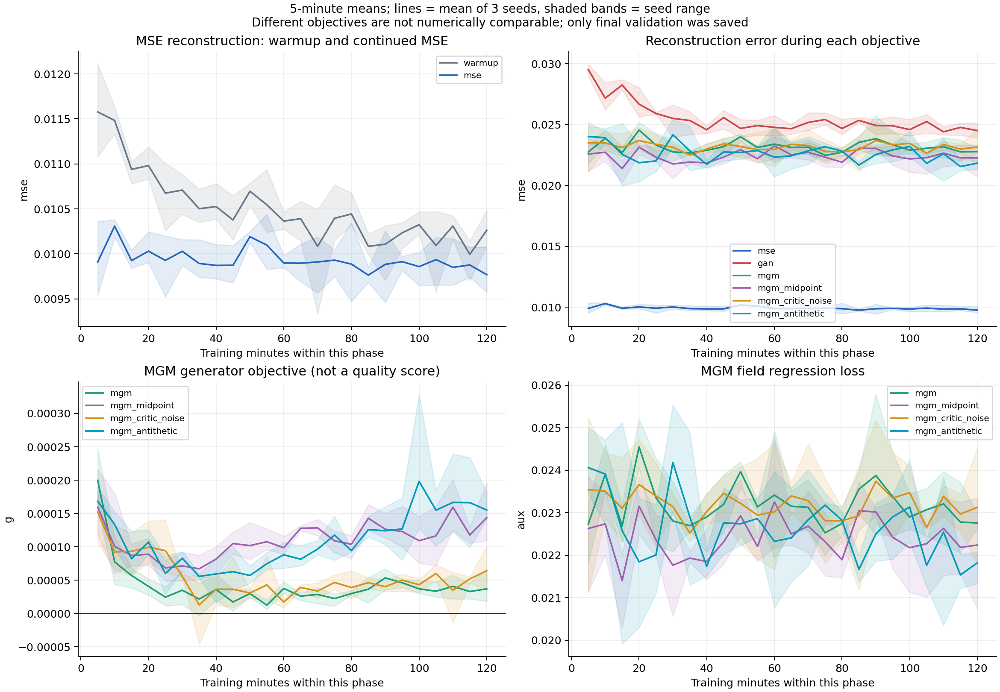
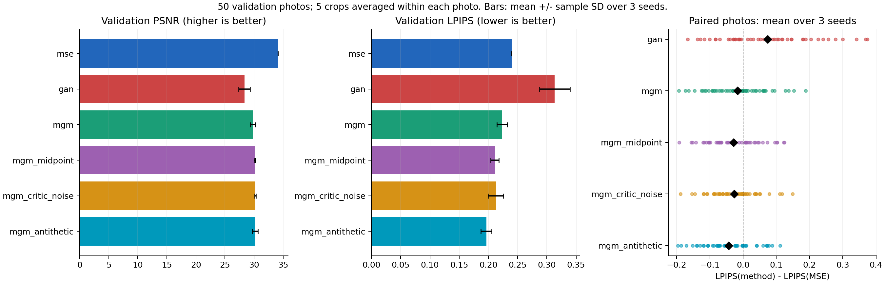
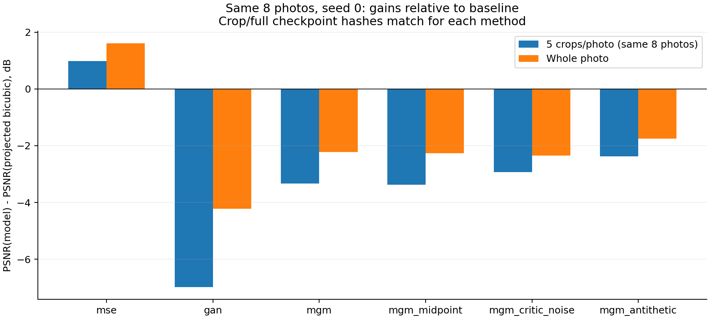

# Анализ обучения MGM I2I — серия full_2h_20261013_202802

Источник: архив пользователя `training_analysis_20261013.tar.gz` и `/Users/kirill/Desktop/full_val`.
Выполнены только чтение сохранённых JSON/логов, статистический анализ и построение графиков. Обучение, инференс и тесты не запускались. Модели и checkpoints не загружались.

## Основной вывод

Все задания завершены штатно. Недостаточный лимит Slurm и массовые FP16-overflow не объясняют артефакты этой серии. Реконструкционная ошибка MGM повышена уже в самом начале основного этапа и остаётся повышенной. Поведение согласуется с проблемой перехода от детерминированного warmup к стохастическому генератору и компромиссом цели MGM; причинность и достаточность обучения поля по этим логам не установлены.

## Проверки целостности и бюджет

- Прочитано 80,593 записей train.jsonl для 3 warmup и 18 основных задач.
- Проверены SHA256 плана, совпадение config с plan, длительность, счётчики обновлений, полнота логов, монотонность шагов/времени и конечность записанных losses.
- Все 21 status имеют complete=true, received_signals=[]; Slurm для всех GPU-задач показывает COMPLETED, ExitCode=0:0. Collect также COMPLETED.
- Все обучались на Tesla V100-SXM2-32GB, torch 2.6.0+cu118; каждый run имеет одну сессию.
- Для каждого seed записан одинаковый init_hash у всех шести методов; data_hash одинаков у всей серии. Самих warmup-checkpoints в архиве нет, их байты повторно не проверялись.
- SHA256 приложенного manifest совпал с data_hash; списки train/val/test не пересекаются по image ID.
- Для всех 18 оценок: 50 фото, 250 crop; числа шагов совпадают с status. У всех шести full-frame запусков SHA256 checkpoint совпадает с crop-evaluation соответствующего seed 0.
- Суммарное время обучения: 42.0003 GPU-часа. Суммарное время 21 GPU-allocation по sacct: 42.4533 GPU-часа (включая запуск/финальную оценку). Это не включает предыдущие попытки и дополнительный full-frame inference.
- Git commit на compute nodes записан как unavailable: точную ревизию исполненного кода по provenance подтвердить нельзя; чтение текущего исходника не заменяет эту проверку.
- Выявленные автоматическими проверками несоответствия: нет.

## Динамика реконструкции

Значения — средние MSE по батчам в указанных окнах, затем среднее трёх seed; изображения нормированы в [-1,1]. Это train-ошибка текущего G, не validation и не EMA. Переходы между окнами могут зависеть от сложности батчей.

| Метод | Первая минута | Первые 10 минут | Последние 10 минут | Последние / первые 10 минут |
|---|---:|---:|---:|---:|
| warmup | 0.01173 | 0.01153 | 0.01013 | 0.878 |
| mse | 0.00949 | 0.01011 | 0.00982 | 0.971 |
| gan | 0.02953 | 0.02834 | 0.02465 | 0.870 |
| mgm | 0.02284 | 0.02333 | 0.02278 | 0.976 |
| mgm_midpoint | 0.02753 | 0.02265 | 0.02227 | 0.983 |
| mgm_critic_noise | 0.02495 | 0.02350 | 0.02308 | 0.982 |
| mgm_antithetic | 0.02609 | 0.02398 | 0.02170 | 0.905 |

Warmup улучшает MSE примерно с 0.01153 до 0.01013 между начальными и конечными 10-минутными окнами. За последние 20 минут изменение небольшое. Дополнительные два часа MSE дают около 0.00982 к концу. Это признаки замедления улучшения train-MSE, не доказательство оптимальности модели или отсутствия переобучения.

MGM работает около 0.022–0.024 с первых минут. У основной MGM средняя MSE первой минуты 0.02284, у продолженного MSE — 0.00949. В конце обычная MGM около 0.02278, antithetic около 0.02170. Резкого позднего роста/численного взрыва нет; само увеличение длительности не обосновано этими кривыми как достаточное исправление.

## Пропуски обновлений и поле

| Метод | Пропуски G по seed | Пропуски auxiliary по seed | Макс. доля G, % | Макс. доля auxiliary, % |
|---|---|---|---:|---:|
| warmup | [48, 48, 48] | [0, 0, 0] | 0.0352 | 0.0000 |
| mse | [50, 44, 49] | [0, 0, 0] | 0.0355 | 0.0000 |
| gan | [0, 0, 0] | [93, 96, 94] | 0.0000 | 0.1009 |
| mgm | [0, 0, 0] | [33, 30, 32] | 0.0000 | 0.0720 |
| mgm_midpoint | [0, 0, 0] | [31, 32, 32] | 0.0000 | 0.0706 |
| mgm_critic_noise | [0, 0, 0] | [28, 31, 30] | 0.0000 | 0.0692 |
| mgm_antithetic | [0, 0, 0] | [17, 18, 17] | 0.0000 | 0.0604 |

У всех GAN/MGM генераторных обновлений skipped_g=0. Редкие пропуски поля/дискриминатора составляют менее 0.11%; оснований объяснять качество массовыми overflow нет. Градиентные нормы, частота срабатывания clipping и история AMP scale не записывались: сами градиенты по этим данным не диагностируются.

У MGM field regression loss близок по порядку к MSE разности концов; generator objective намного меньше и колеблется. Это совместимо и с небольшим условным средним displacement, и со слабым полем. При совпадении распределений regression loss не обязан быть нулём. Поэтому утверждать, что поле точно не обучилось, нельзя. У midpoint и antithetic generator objective после раннего снижения снова дрейфует вверх; численного доказательства стационарного minimax-равновесия нет.

## Validation и неоднородность по фотографиям

| Метод | PSNR mean ± SD | LPIPS mean ± SD | Фото с LPIPS лучше MSE, из 50 |
|---|---:|---:|---:|
| mse | 34.102 ± 0.021 | 0.23994 ± 0.00010 | 0 |
| gan | 28.349 ± 0.982 | 0.31340 ± 0.02593 | 18 |
| mgm | 29.784 ± 0.442 | 0.22342 ± 0.00897 | 28 |
| mgm_midpoint | 30.101 ± 0.125 | 0.21118 ± 0.00705 | 32 |
| mgm_critic_noise | 30.220 ± 0.121 | 0.21285 ± 0.01317 | 35 |
| mgm_antithetic | 30.187 ± 0.461 | 0.19645 ± 0.00906 | 38 |

Счётчик фото сравнивает LPIPS после усреднения трёх seed внутри каждой фотографии. Пять crop одной фотографии не считаются независимыми наблюдениями. Это описательная статистика, не проверка значимости по 150 независимым примерам и не доказательство превосходства на новых seed.

Antithetic улучшает средний LPIPS, но хуже MSE на 12 из 50 фото по этому критерию. В просмотренных crop-grid MGM уже показывает зерно и искусственные текстуры; артефакты не впервые появляются в полном кадре. LPIPS не оптимизируется напрямую ни одним из этих losses и не заменяет визуальную проверку.

## Полные фотографии и гипотеза GroupNorm

Сопоставлены ровно те же восемь фото и seed 0; checkpoint hashes совпали. Однако набор пикселей/контекст и способ усреднения метрик у crop и full различаются. Поэтому даже это сопоставление не является изолированным тестом размера входа.

| Метод | PSNR на 5 crop тех же фото | PSNR целого кадра | Crop: выигрыш над projected bicubic | Full: выигрыш над projected bicubic |
|---|---:|---:|---:|---:|
| mse | 35.604 | 30.118 | +0.980 | +1.607 |
| gan | 27.641 | 24.283 | -6.983 | -4.228 |
| mgm | 31.295 | 26.284 | -3.329 | -2.227 |
| mgm_midpoint | 31.247 | 26.243 | -3.378 | -2.268 |
| mgm_critic_noise | 31.700 | 26.167 | -2.924 | -2.344 |
| mgm_antithetic | 32.246 | 26.758 | -2.378 | -1.753 |

У самого projected bicubic, где нет GroupNorm и обученной сети, PSNR меняется с 34.624 на crop до 28.511 на полном кадре. Значительная часть разницы абсолютных чисел объясняется самим протоколом оценки/выбором областей и нелинейностью PSNR. Относительно этого baseline все методы на полном кадре выглядят не хуже, чем на пяти crop той же выборки. Это ослабляет объяснение «виноват только полный размер». Влияние GroupNorm остаётся возможным, но не доказанным.

## Кандидат на причину: переход от G(c,0) к G(c,z)

В текущем engine warmup/MSE получает нулевой latent, тогда как MGM/GAN получает Gaussian latent сразу с начала основного этапа. В Generator входные каналы latent идут в обычную Conv2d stem. При z=0 вклад этих весов равен нулю, и градиент по latent-channel весам stem равен нулю. При стандартном Adam без weight decay эти веса остаются исходными случайными весами, тогда как остальная сеть обучается.

Следовательно, общий checkpoint обеспечивает одинаковые веса, но не одинаковое начальное качество для нулевого и случайного latent. После warmup случайный z может сразу возбудить нежелательные высокие частоты. Начальный скачок train-MSE с этим согласуется, однако первые сохранённые записи уже после 20 обновлений: контролируемого измерения до первого обновления нет. Это проверяемая гипотеза, а не доказанный единственный источник артефактов.

Дополнительно: чистая MGM после warmup не штрафует отклонение от единственного HR-target через MSE; поле конечной мощности и неточное minimax-решение могут не подавлять нежелательные текстуры. Детерминированный MSE и стохастический генератор также имеют различный ожидаемый distortion даже при корректном сэмплировании условного распределения, поэтому сам рост MSE не доказывает ошибку MGM.

В частности, пусть Y и Y′ — независимые samples правильного условного распределения при фиксированном c. Тогда E||Y′−Y||² = 2·tr Cov(Y|c), а E||E[Y|c]−Y||² = tr Cov(Y|c). Поэтому корректный стохастический генератор может иметь вдвое большую MSE, чем точное условное среднее. Наши модели не являются доказанными точными решениями, но это объясняет, почему одного отношения ошибок около двух недостаточно для диагноза.

## Что делать дальше

1. Сначала короткая диагностика без нового обучения: на warmup checkpoint сравнить G(c,0) и G(c,alpha*z) при alpha=0,0.1,0.25,0.5,1 на фиксированных validation inputs. Повторить на готовых MGM checkpoints. Измерить шум гладкого фона и показать обе генерации; не выбирать alpha по held-out test и не выдавать alpha=0 за результат исходной стохастической модели.
2. Проверить размер входа на одинаковых областях: MSE с z=0 снимает фактор случайного latent; для MGM использовать согласованное поле z и вырезать его вместе с LR. Сравнивать центральную область полного результата с отдельно обработанной областью, отдельно учитывая контекст и padding.
3. Если гипотеза инициализации подтверждается, новый небольшой контролируемый опыт: noise-aware MSE warmup с тем же latent distribution либо архитектура с контролируемым вводом stochastic residual. Отдельно сравнить чистую MGM и MGM + reconstruction loss; не менять одновременно initializer, архитектуру, noise scale и loss.
4. Для следующего обучения сохранять отдельные checkpoints и фиксированную validation каждые 10–15 минут; логировать gradient norms, clipping, AMP scale и нормы/качество поля. Лишь после этого выбирать длительность по кривой качества, а не по train-loss.

## Что текущие данные не позволяют заключить

- Нет промежуточных checkpoints/validation: нельзя найти лучший момент или доказать переобучение.
- Нет field-only диагностики: нельзя доказать, что поле отстаёт или переобучено.
- Нет контрольного noisy warmup и снимка до шага 1: влияние latent cold start пока гипотеза.
- Есть только 3 seed, полный кадр проверен только на 8 фото/seed 0.
- Ни низкий/отрицательный generator loss, ни высокий diversity не доказывают совпадение условных распределений или хорошее визуальное качество.

Данные для воспроизведения расчётов: `diagnostics.json`, `training_windows.csv`, `summary.json`; код анализа: `analyze_logs.py`.
